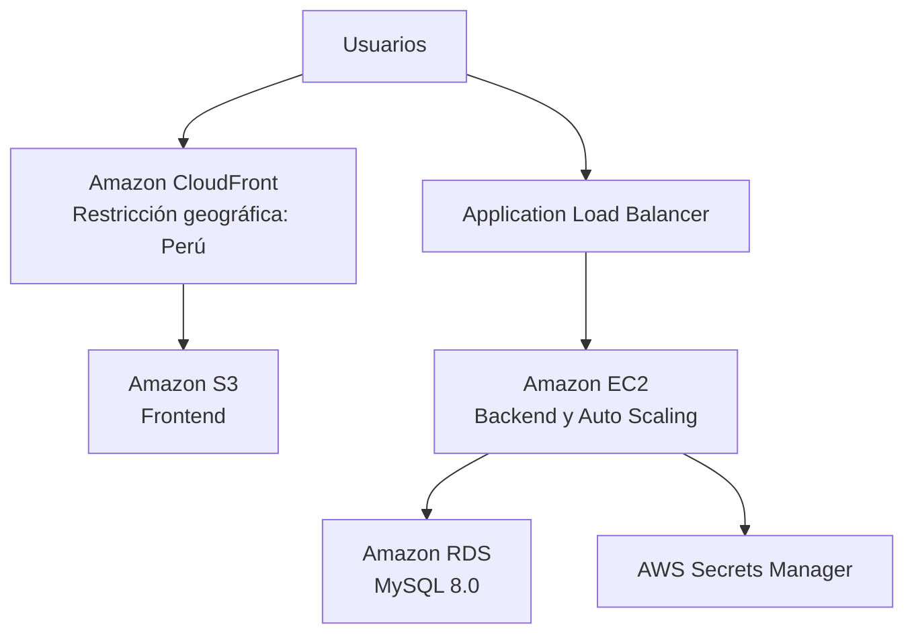

# Infraestructura como Código – Sistema Web de Citas y Gestión Odontológica

## 1. Descripción del proyecto

El presente proyecto consiste en el diseño e implementación de infraestructura como código (IaC) mediante Terraform sobre Amazon Web Services (AWS), para el Sistema Web de Citas y Gestión Odontológica del Centro Dental San José, ubicado en Trujillo, Perú.

El objetivo es proporcionar una infraestructura organizada, escalable y segura que permita soportar la gestión de citas odontológicas, el acceso de pacientes y las operaciones administrativas del centro dental.

La infraestructura se desarrolla considerando la disponibilidad de los servicios, la protección de la información, el control de acceso y las buenas prácticas de seguridad en la nube.

## 2. Tecnologías y servicios utilizados

- Amazon Web Services (AWS)
- Terraform
- Amazon VPC
- Amazon EC2
- EC2 Auto Scaling
- Application Load Balancer (ALB)
- Amazon S3
- Amazon CloudFront
- Amazon RDS
- AWS Secrets Manager
- Security Groups
- Checkov
- Conftest
- Open Policy Agent (OPA)
- Git y GitHub

## 3. Arquitectura de infraestructura

La infraestructura contempla una arquitectura distribuida en AWS, organizada en diferentes componentes.

### 3.1. Capa de red

- VPC para aislar los recursos del proyecto.
- Subredes públicas y privadas.
- Internet Gateway para la conectividad de las subredes públicas.
- Tablas de rutas para administrar el tráfico de red.
- Zonas de disponibilidad para distribuir los recursos.

### 3.2. Capa de frontend

- Amazon S3 para almacenar los archivos del frontend.
- Amazon CloudFront para distribuir el contenido.
- Origin Access Control (OAC) para restringir el acceso al bucket S3 a través de CloudFront.
- Restricción geográfica configurada para permitir el acceso desde Perú.

### 3.3. Capa de aplicación

- Application Load Balancer para distribuir las solicitudes.
- Instancias Amazon EC2 para ejecutar el backend.
- Auto Scaling para administrar la capacidad de procesamiento.

### 3.4. Capa de base de datos

- Amazon RDS para almacenar la información del sistema.
- Configuración actual del motor MySQL 8.0.
- Almacenamiento cifrado.
- Grupo de subredes privadas para la base de datos.
- Protección contra eliminación accidental.

### 3.5. Capa de seguridad

- Security Groups para controlar las comunicaciones entre componentes.
- AWS Secrets Manager para almacenar credenciales y secretos.
- Políticas personalizadas con OPA y Conftest.
- Análisis de seguridad mediante Checkov.

## 4. Diagrama general de arquitectura



**Nota:** La restricción geográfica está configurada en CloudFront. Para garantizar que también el acceso directo al backend/API esté limitado a Perú, se debe implementar y verificar un control geográfico adicional, por ejemplo, mediante AWS WAF.

## 5. Estructura del proyecto

```text
proyecto-iac/
│
├── main.tf
├── networking.tf
├── variables.tf
├── security_groups.tf
├── compute.tf
├── database.tf
├── load_balancer.tf
├── frontend.tf
├── security.tf
├── .gitignore
├── README.md
│
└── policy/
    ├── ssh.rego
    ├── tags.rego
    │
    └── testdata/
        ├── plan-seguro.json
        └── plan-inseguro.json
```

### Descripción de archivos

| Archivo | Función |
|---|---|
| main.tf | Configuración principal de Terraform. |
| networking.tf | Componentes de red y conectividad. |
| variables.tf | Declaración de variables. |
| security_groups.tf | Grupos y reglas de seguridad. |
| compute.tf | Plantilla EC2 y Auto Scaling. |
| database.tf | Configuración de Amazon RDS. |
| load_balancer.tf | Balanceador de carga. |
| frontend.tf | Bucket S3 y distribución CloudFront. |
| security.tf | Administración de secretos y credenciales. |
| policy/ssh.rego | Políticas de seguridad SSH. |
| policy/tags.rego | Validación de etiquetas de recursos. |

## 6. Seguridad y buenas prácticas

El proyecto incorpora diferentes mecanismos para fortalecer la seguridad de la infraestructura:

- Segmentación de la red mediante VPC y subredes.
- Restricción del acceso a los recursos mediante Security Groups.
- Protección del bucket S3 mediante políticas de acceso y CloudFront OAC.
- Restricción geográfica de la distribución CloudFront para Perú.
- Almacenamiento de credenciales en AWS Secrets Manager.
- Cifrado del almacenamiento de la base de datos.
- Exclusión de archivos sensibles y temporales mediante `.gitignore`.
- Validación de políticas de seguridad con OPA y Conftest.
- Análisis estático de infraestructura con Checkov.

## 7. Validación de la infraestructura

Para verificar la configuración se utilizaron las siguientes herramientas:

### 7.1. Terraform

Se ejecutaron los comandos:

```bash
terraform fmt -recursive
terraform validate
```

**Resultado:** configuración válida y archivos formateados correctamente.

### 7.2. Checkov

Se realizó un análisis de seguridad sobre los archivos Terraform:

```bash
checkov -d . --framework terraform --output cli
```

Resultados de la última ejecución:

| Resultado | Cantidad |
|---|---:|
| Passed checks | 110 |
| Failed checks | 16 |
| Skipped checks | 9 |

Los resultados permiten identificar controles aprobados, hallazgos pendientes y verificaciones omitidas mediante comentarios de supresión.

### 7.3. Conftest y OPA

Se validaron las políticas personalizadas mediante:

```bash
conftest test plan-entrega3-final.json --policy policy
```

Resultado de la ejecución realizada:

- 4 pruebas ejecutadas.
- 4 pruebas aprobadas.
- 0 advertencias.
- 0 fallos.

## 8. Instalación y preparación del entorno

Para trabajar con el proyecto se requiere:

- Terraform.
- AWS CLI.
- Credenciales de AWS configuradas de forma segura.
- Checkov.
- Conftest.

Inicializar Terraform:

```bash
terraform init
```

Formatear los archivos:

```bash
terraform fmt -recursive
```

Validar la configuración:

```bash
terraform validate
```

Generar un plan de ejecución:

```bash
terraform plan -out=plan.tfplan
```

Convertir el plan a JSON para validar las políticas:

```bash
terraform show -json plan.tfplan > plan.json
```

Ejecutar Conftest:

```bash
conftest test plan.json --policy policy
```

Ejecutar Checkov:

```bash
checkov -d . --framework terraform --output cli
```

## 9. Consideraciones y mejoras pendientes

Aunque la infraestructura cuenta con validaciones de formato, sintaxis y políticas personalizadas, existen controles que deben revisarse antes de considerar el entorno listo para producción.

Entre ellos:

- Configurar HTTPS en el Application Load Balancer y TLS 1.2 o superior.
- Habilitar los registros de acceso del balanceador.
- Revisar los hallazgos pendientes de Checkov.
- Revisar la configuración de las zonas de disponibilidad.
- Incorporar protección geográfica para el acceso directo al backend/API.
- Alinear el motor MySQL configurado en Terraform con el diseño académico original que contempla PostgreSQL.
- Revisar la configuración de alta disponibilidad y respaldos de la base de datos.

Los resultados de Checkov deben interpretarse como parte del proceso continuo de revisión de seguridad y no como una certificación de que toda la infraestructura está libre de riesgos.

## 10. Despliegue y administración

Antes de ejecutar cualquier despliegue en AWS, se debe revisar el plan generado por Terraform, verificar los permisos necesarios y evaluar los costos asociados a los servicios.

Para aplicar los cambios, después de revisar el plan:

```bash
terraform apply plan.tfplan
```

Para eliminar los recursos administrados por Terraform, cuando corresponda:

```bash
terraform destroy
```

Estos comandos deben ejecutarse únicamente después de verificar los recursos involucrados y las consecuencias de cada operación.

## 11. Protección del repositorio

El repositorio utiliza `.gitignore` para evitar publicar información sensible o archivos generados localmente.

No se deben subir:

- Archivos `.tfstate`.
- Archivos `.tfplan`.
- Archivos `.tfvars`.
- Credenciales y claves de AWS.
- Archivos `.env`.
- Directorios `.terraform/`.
- Planes JSON generados localmente.
- Informes locales de Checkov.

Los archivos de configuración, las políticas Rego, los datos de prueba no sensibles y la documentación del proyecto sí forman parte del código fuente que se mantiene en GitHub.

## 12. Repositorio

**Proyecto:** Sistema Web de Citas y Gestión Odontológica.

**Curso:** Infraestructura como Código.

**Plataforma:** Amazon Web Services (AWS).

**Herramienta principal:** Terraform.

**Rama de trabajo:** `entrega-3-seguridad`.

**Repositorio GitHub:**

https://github.com/LuisLobaton/Sistema-Web-Odontog-gico